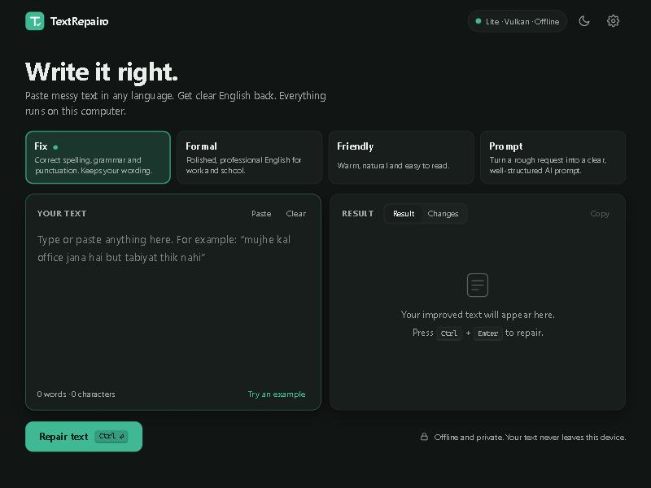
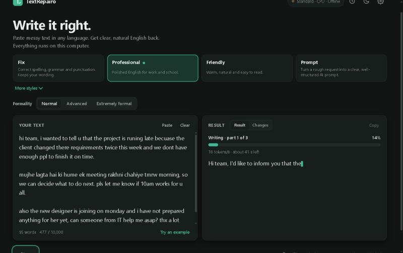
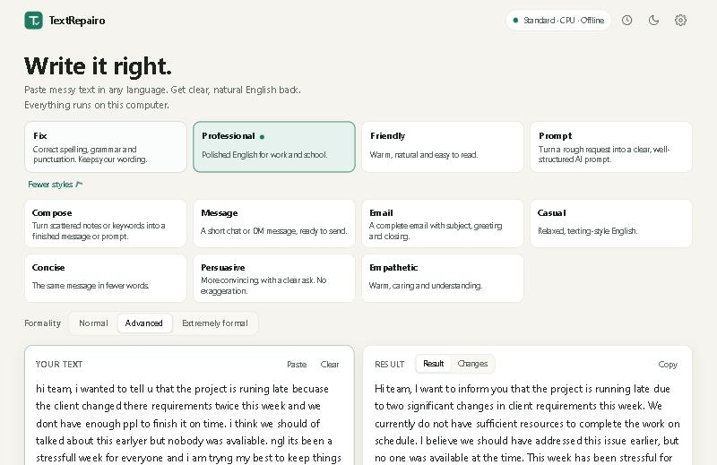

<p align="center">
  
</p>

<h1 align="center">TextRepairo</h1>
<p align="center"><b>Write it right.</b><br>Paste messy text in any language and get clear, natural English back. It runs on your own computer, with no account and no cloud.</p>

<p align="center">
  <a href="https://github.com/p4inz-code/TextRepairo/releases/latest"><b>Download</b></a> &nbsp;|&nbsp;
  <a href="https://github.com/p4inz-code/TextRepairo/issues/new/choose">Report a bug or an idea</a> &nbsp;|&nbsp;
  <a href="https://discord.gg/8UKt8s5FbW">Discord</a> &nbsp;|&nbsp;
  <a href="PRIVACY.md">Privacy</a> &nbsp;|&nbsp;
  <a href="ROADMAP.md">Roadmap</a>
</p>

<p align="center">
  <a href="https://github.com/p4inz-code/TextRepairo/releases/latest"></a>
  <a href="https://github.com/p4inz-code/TextRepairo/releases"></a>
  <a href="LICENSE"></a>
</p>

TextRepairo turns bad spelling, broken grammar, chat shorthand and mixed-language text ("mujhe kal office jana hai but tabiyat thik nahi") into English that sounds like a person wrote it. You pick a style, press **Ctrl+Enter**, and look at the result. A *Changes* view shows exactly what was altered, so you stay in control.

A small AI model does the work on your own computer (Apache-2.0 Qwen3 models through llama.cpp). Your text is never uploaded.

## Get TextRepairo

Take the file for your system from the [latest release](https://github.com/p4inz-code/TextRepairo/releases/latest). Each release has a `SHA256SUMS.txt`, a software bill of materials and a build attestation.

| System | File | Notes |
|---|---|---|
| Windows 10/11 | `TextRepairo-Setup-<version>.exe` | Installs for your user, no administrator prompt. Can update itself. |
| Windows 10/11, portable | `TextRepairo-<version>-windows-x64-portable.zip` | Unzip anywhere. Models, settings and history stay in the `data` folder next to the app. |
| macOS (Apple Silicon) | `TextRepairo-<version>-macos-arm64.dmg` | Open it and drag TextRepairo to Applications. |
| Linux (x64) | `.AppImage`, `.deb` or `.tar.gz` | The `.tar.gz` is portable. On Linux the app opens in your browser. |

The first time you open it, TextRepairo asks you to download one AI model (1 to 5 GB) and then works offline.

> **Status: 0.2, usable every day on Windows.** Windows is the system I test hardest. The macOS and Linux builds are built and smoke-tested by CI, but I have not run them on real machines yet, so expect rough edges there. On the first start Windows may show a SmartScreen notice: choose choose *More info > Run anyway*, on macOS right-click the app and choose *Open* (or run `xattr -cr /Applications/TextRepairo.app`). To check a download, compare its checksum or use the build attestation (`gh attestation verify <file> --repo p4inz-code/TextRepairo`).
>
> Output is **English** for now. Hindi, Marathi and Hinglish output are planned. See the [roadmap](ROADMAP.md) and [known limits](CHANGELOG.md).

<table>
<tr>
<td width="50%" align="center">
<sub>A real progress bar: percentage, part, speed and time left</sub><br><br>

</td>
<td width="50%" align="center">
<sub>Light theme with eleven styles and three formality levels</sub><br><br>

</td>
</tr>
</table>

## How to use it (3 easy ways)

All three do the same job. Pick the one you like. The full step-by-step guide is in [docs/GUIDE.md](docs/GUIDE.md).

### 1. The app (easiest)
1. Open **TextRepairo**. The first time, download a model when it asks (pick **Standard**). You only do this once.
2. **Paste your text** in the left box. It can be messy, full of slang, or in another language.
3. **Pick a style** (Fix, Professional, Friendly, Email, and more). For formal styles you can also pick how formal: Normal, Advanced or Extremely formal.
4. Press **Repair text** (or **Ctrl+Enter**). Watch the progress bar.
5. Read the result on the right. **Changes** shows what was altered. **Copy** copies it.

Your last 100 results are in **History** (clock icon). Something not working? Open **Settings > Doctor**.

### 2. The web page (same screen, in your browser)
Open a terminal and run:

```bash
textrepairo serve
```

It opens a page in your browser. Use it exactly like the app. Only your own computer can open it. Press **Ctrl+C** in the terminal to stop it. (Windows installer: the command is `textrepairo-cli.exe` in the install folder. See the guide.)

### 3. The command line (for files and scripts)

```bash
textrepairo repair "i dont no wat to do abt this"                       # fix a sentence
textrepairo repair "cant come tmrw" -m professional --formality advanced  # pick a style
echo "bro cant come today got fever" | textrepairo repair -m message     # pipe text in
textrepairo repair -f notes.txt -o fixed.txt                             # fix a file
textrepairo repair -f a.txt -f b.txt --out-dir fixed/                    # fix many files
```

More commands: `textrepairo history list`, `textrepairo doctor`, `textrepairo update`, `textrepairo --help`.

## What it does

- **Eleven styles.** *Fix* (spelling and grammar, keeps your wording), *Professional*, *Friendly*, *Prompt* (turn a rough request into a clear AI prompt), *Compose* (turn scattered notes into a finished message or prompt), *Message*, *Email*, *Casual*, *Concise*, *Persuasive* and *Empathetic*.
- **Three formality levels** for the styles where it matters: Normal, Advanced, Extremely formal.
- **Sounds like a person.** Every style follows "write like a person" rules, and a safety net removes stock AI phrases and em dashes that you did not write. It does not claim to fool AI detectors.
- **Understands slang and mixed languages.** Built-in packs cover English chat shorthand and slang, Hindi/Hinglish and Marathi written in English letters. You can add your own packs ([docs/PACKS.md](docs/PACKS.md)).
- **A real progress bar.** The percentage, the part you are on, the speed and the time left come from real counters. Writing is an estimate, so the bar never shows 100% before the result is done. Loading the model shows seconds, not a made-up percentage.
- **History** of your last 100 results, on your computer only. Switch it off, use Private mode, or clear it any time. Deleted text is overwritten.
- **Protected spans.** Links, code, emails and file paths are kept exactly as you wrote them. Numbers that go missing trigger a warning.
- **Doctor and About** inside the app. Doctor checks the engine, the model (with a checksum), your data folder and that nothing is reachable from the network.
- **Cool and quiet by default.** The engine runs at low priority and uses at most half of your CPU threads (never more than 8). GPU acceleration is optional.
- **Desktop app, web UI and command line** from the same core.

Up to 10,000 characters per repair.

## How private is it?

- Your text goes only to programs running on your own computer, on `127.0.0.1`.
- No account, no analytics, no crash reports, no telemetry.
- The only network requests are an optional once-a-day update check (a plain request to this project's GitHub releases, with nothing about you in it) and downloads you start yourself (models from Hugging Face, the engine from GitHub). Both are verified against pinned checksums. Turn updates off under **Settings > Updates**.
- Details: [PRIVACY.md](PRIVACY.md), [SECURITY.md](SECURITY.md) and [docs/THREAT_MODEL.md](docs/THREAT_MODEL.md).

## Models

| Model | Size | For |
|---|---|---|
| Lite, Qwen3 1.7B | about 1.1 GB | old laptops, 8 GB RAM. Lower quality on hard text. |
| **Standard**, Qwen3 4B Instruct 2507 | about 2.5 GB | most computers. Recommended. |
| Pro, Qwen3 8B | about 5 GB | a GPU with 8 GB or more, or 16 GB+ RAM |

You can also import your own `.gguf` file. All built-in models are Apache-2.0.

## Quality, honestly

Small models can sometimes rewrite more than you want or be fooled by tricky text. That is why there is a *Changes* view and warnings. The repository has an evaluation suite of 161 test cases (English errors, slang, Hinglish and Marathi in English letters, other languages, styles, formality, Compose, protected text and 34 prompt-injection attacks). Results and what was and was not measured are in [docs/EVAL.md](docs/EVAL.md). Please run it on your own hardware and report cases that fail.

## FAQ

**Does it need the internet?** Only to download a model once, and for the optional update check. Everything else is offline.

**Why English only?** English output is first so it can be good. Hindi, Marathi and Hinglish output come next, each with its own tests and a native speaker's review.

**Can I use it for school or work?** Yes. It is a writing helper. Read the result before you send it.

**Where is my data?** In the data folder shown in **Settings > About** (or the `data` folder next to the portable app). Delete it and everything is gone.

**How do I uninstall?** Windows: *Settings > Apps > Installed apps > TextRepairo*. Your data folder stays until you delete it. macOS: drag the app out of Applications. Linux: delete the AppImage or remove the package.

## Build it yourself

```bash
pip install -e ".[dev,desktop]"
python -m pytest
python -m textrepairo serve
python scripts/build_app.py       # standalone app in dist/
```

Guide for users: [docs/GUIDE.md](docs/GUIDE.md). For developers: [docs/DEVELOPMENT.md](docs/DEVELOPMENT.md) and [CONTRIBUTING.md](CONTRIBUTING.md). Planning documents live in [docs/plans](docs/plans).

## License

TextRepairo is free software under the **GNU General Public License v3 or later**, with the short additional terms in [ADDITIONAL_TERMS.md](ADDITIONAL_TERMS.md) (the credit stays, changed versions are marked, the name is reserved). Models and libraries keep their own licenses: [THIRD_PARTY_NOTICES.md](THIRD_PARTY_NOTICES.md).

Copyright © 2026 Atharva Patil — P4inz Interactive Labs.

## More

[Guide](docs/GUIDE.md) · [Known issues](docs/KNOWN_ISSUES.md) · [Changelog](CHANGELOG.md) · [Roadmap](ROADMAP.md) · [Privacy](PRIVACY.md) · [Security](SECURITY.md) · [Threat model](docs/THREAT_MODEL.md) · [Slang packs](docs/PACKS.md) · [Quality notes](docs/EVAL.md) · [Audits](docs/audits/v0.2/SUMMARY.md) · [Releasing](docs/RELEASING.md) · [Support](SUPPORT.md) · [Contributing](CONTRIBUTING.md) · [Code of conduct](CODE_OF_CONDUCT.md)

## Support and feedback

- Bugs and ideas: [issues](https://github.com/p4inz-code/TextRepairo/issues/new/choose). In the app, open **Settings > Doctor > Copy report** and paste it. The report never contains your text.
- Chat: [Discord](https://discord.gg/8UKt8s5FbW)
- More from the same author: [atharvapatil.tech](https://atharvapatil.tech)

### Support my work

I make these tools on my own and keep them free. If one helped you, you can chip in by UPI (India) or with a coffee, any amount.

[Support page (UPI)](https://p4inz-code.github.io/donate/) &nbsp;|&nbsp; [Buy me a coffee](https://buymeacoffee.com/p4inz)
